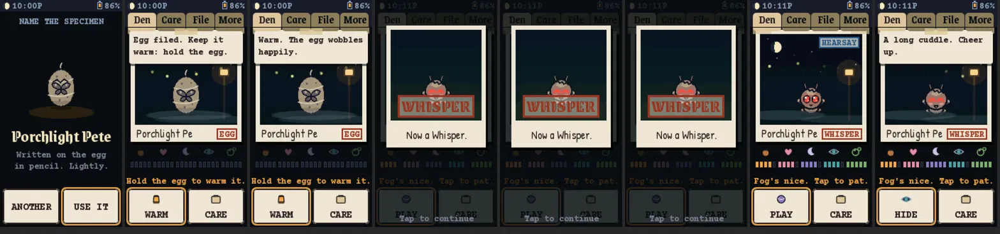
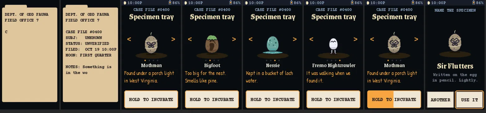
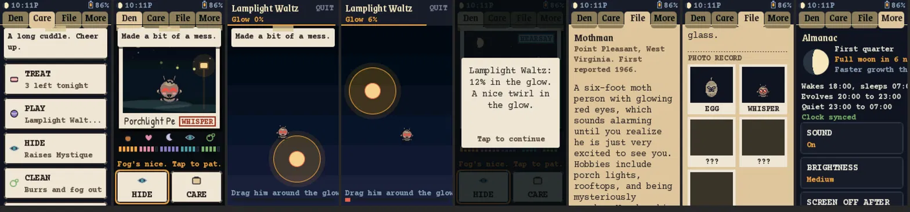
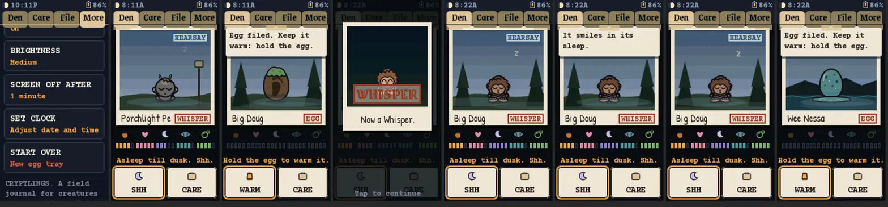
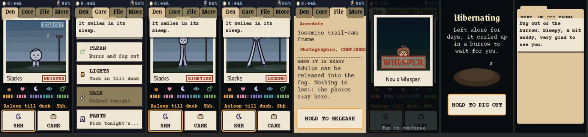
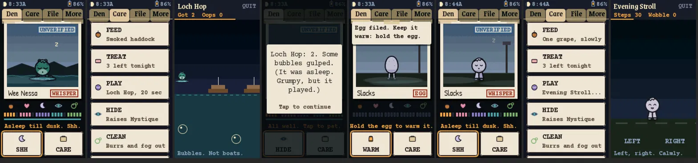
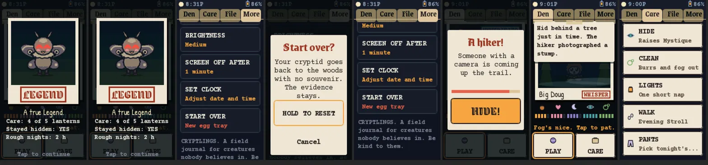
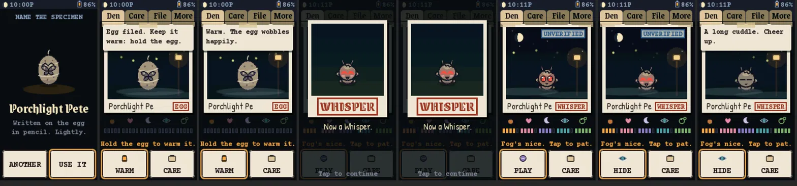
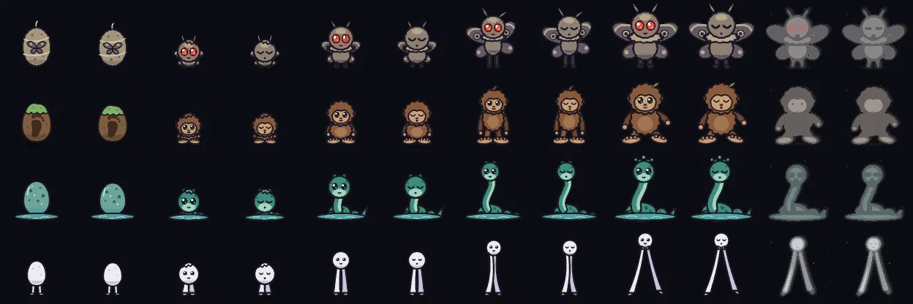

# CRYPTLINGS

A cozy, gently creepy virtual pet for the Waveshare ESP32-C6-Touch-LCD-1.47. You are a field agent for the Dept. of Odd Fauna. At first boot you pick one of four cryptid eggs (Mothman, Bigfoot, Nessie, or the Fresno Nightcrawler), name it, and raise it to an adult on the real clock. Cryptids are nocturnal: they wake at dusk, want attention in the evening, and sleep through the day. Well raised adults become a **LEGEND**, neglected ones a **BLURRY PHOTO**, spoiled ones a **HOAX**. Nothing dies.

The theme is a cryptozoologist's field journal at midnight: case files, polaroids, rubber stamps, fog and fireflies. Never techno, never horror.



## Features

- **Four cryptids, six forms each.** Egg, Whisper, Rumor, Sighting, then one of three adults. Each species has its own quirk: Mothman has a porch lamp and gets dizzy, Bigfoot dodges hikers with cameras and forages, Nessie needs her loch topped up, the Nightcrawler walks at night and picks its pants.
- **Real clock, real moon.** The pet runs on local time with a dawn tuck-in, owner quiet hours (23:00 to 07:00) and the real moon phase. Evolutions only happen live in the evening window (20:00 to 23:00). A full moon brings them early.
- **Direct care is always enough.** Feed, treat, pat, cuddle, play, hide, clean, lights out. Nothing required depends on WiFi, Bluetooth or location.
- **Four 20 second minigames.** Lamplight Waltz (drag the moth around the glow), Forage (tap), Loch Hop (tap the bubbles, not the boats) and Evening Stroll (alternate taps; it is also the walk).
- **Evidence and case files.** Check-ins roll folklore evidence in five tiers from Hearsay to Irrefutable, with corroboration counts kept across pets. The File tab holds the bio, the photo record of every form reached, and the release ceremony.
- **Time away is handled kindly.** Up to 72 hours of absence is caught up at half decay with a floor of 10 on every stat. Longer than that and the pet is found hibernating in a burrow; hold to dig it out.
- **Battery aware.** Screen timeout, battery saver with processor light sleep, a soft power off to deep sleep on a 3 second hold of the wake button, and a battery reading once a minute.
- **Sound motifs** on an external passive buzzer, respecting quiet hours and capped at six unattended sounds a day.
- **Host-testable engine and a desktop simulator.** The engine has no Arduino dependencies, so it builds on a Mac or Linux box with g++. The simulator renders every screen with scripted touches and writes screenshots, which is where most UI work was checked before flashing.

## Screenshots

Captured from the desktop simulator, which runs the exact firmware drawing code at the panel's 172 x 320 resolution.

| | |
|---|---|
|  | Boot case file, the specimen tray, hold to incubate, naming |
|  | Care list, the Lamplight Waltz minigame, the File tab and the Almanac |
|  | Settings, a day asleep, Bigfoot hatching, Nessie's egg in the loch |
|  | The Nightcrawler growing up, walks and pants, release, hibernating and dig-out |
|  | Nessie's Loch Hop and the Nightcrawler's Evening Stroll |
|  | The Legend fork card, the start-over confirm, a Bigfoot hiker alert |
|  | Mothman's first night with an unverified clock |

The sprite sheet (4 species x 6 forms, awake and asleep):



## Hardware

- **Waveshare ESP32-C6-Touch-LCD-1.47**: 172 x 320 IPS (JD9853 over SPI), AXS5106L capacitive touch, ESP32-C6 at 160 MHz, 512 KB SRAM, no PSRAM, 8 MB flash, LiPo charging.
- **A momentary push button** between GPIO7 and GND (you add it). Tap wakes the screen or turns it off; hold 3 seconds for a soft power off. GPIO7 is the only free pin that can wake the chip from deep sleep.
- **A small passive piezo buzzer** between GPIO17 and GND (you add it; the board has none). Optional 100 ohm resistor in series.
- Optional: a LiPo cell on the battery connector.

Pins, the display init table, the touch protocol, battery notes and the reason the red power LED never turns off are in [docs/HARDWARE.md](docs/HARDWARE.md). The full player's guide is [docs/CRYPTLINGS_Guide_v1.pdf](docs/CRYPTLINGS_Guide_v1.pdf).

## Install

### Prebuilt firmware

Grab the binaries from the [latest release](https://github.com/hey-its-brian/cryptlings/releases/latest) and flash with esptool:

```bash
esptool.py --chip esp32c6 write_flash 0x0 cryptlings-v1.0.0-full.bin
```

The full image at `0x0` includes the bootloader and partition table and **wipes any saved pet and settings**. To keep them, flash the app image alone at `0x10000`:

```bash
esptool.py --chip esp32c6 write_flash 0x10000 cryptlings-v1.0.0-app.bin
```

The board shows up as a USB JTAG/serial device. If it does not respond, hold BOOT while plugging in USB to enter download mode.

### Build from source

Requires [PlatformIO](https://platformio.org/). The ESP32-C6 needs Arduino core 3.x, which comes from the pioarduino platform pinned in `platformio.ini`.

```bash
pio run -t upload && pio device monitor
```

Useful build flags (add to `build_flags` in `platformio.ini`):

| Flag | Effect |
|---|---|
| `-DWIFI_SSID=\"name\" -DWIFI_PASS=\"pass\"` | Sync the clock over NTP at boot. Without it the clock is flagged UNVERIFIED and can be set on the MORE tab |
| `-DTZ_RULE=\"...\"` | POSIX time zone rule. Defaults to America/New_York |
| `-DBUZZER_PIN=<n>` | Buzzer pin, `-1` for silence. Default 17 |
| `-DWAKE_BUTTON_PIN=<n>` | Wake button pin, `-1` for none. Default 7 |
| `-DLCD_SPI_HZ=80000000` | Faster SPI for the panel. Default 40 MHz |

## Host builds

No board needed for these.

```bash
make -f host.mk test    # engine regression tests and the 20 day balance matrix
make -f host.mk trace   # the same with a verbose stat trace
make -f host.mk sim     # renders every screen and flow to build/shots/ (PPM)
```

### Balance

Twenty simulated days per species and keeper, from the host tests:

| Keeper | What they do | Outcome |
|---|---|---|
| good | 5 short evening sessions and a dawn tuck-in | LEGEND, score about 90 |
| casual | 2 evening sessions of full care, tuck-in every other day | LEGEND (80 to 83), except Bigfoot: BLURRY PHOTO, because unanswered hikers eat Mystique |
| lazy | 1 quick session a night, never hides | BLURRY PHOTO (25 to 30) |
| neglect | feeds every other day | BLURRY PHOTO, grows up late |
| spoiler | good care plus 3 treats a night | HOAX |

Adults arrive on the evening of day 8 (Nessie day 10). Every number lives in the `Tuning` struct in `include/cryptlings_core.h` and is meant to be tuned.

## How it is put together

```
include/cryptlings_core.h   engine API, Tuning (every number is tunable), POD State
src/cryptlings_core.cpp     the engine: stats, schedule, quirks, lifecycle, fork, evidence, catch-up
src/app/                    portable UI: renderer, every screen, overlays, minigames, sound cues
src/assets/                 generated: 4bpp fonts and 16-color sprites, scenes and icons
src/hal/board.*             display, touch, backlight, buzzer, battery, buttons, sleep
src/main.cpp                firmware: wires the app to the board, NVS saves, clock, debug console
sim/sim_main.cpp            desktop simulator with scripted touches
host_test/test_host.cpp     engine tests and the balance matrix
tools/                      bake_fonts.py, art/render.js and bake_sprites.py (regenerate assets)
docs/                       HARDWARE.md and the player's guide
```

The engine is pure C++17 with a plain-old-data `State` (244 bytes, CRC checked) that is saved to NVS on every event, every 10 minutes, on screen off and before power off. The UI layer talks to the board through a small platform interface, so the same code draws on the panel and in the simulator.

### Regenerating the art

The chibi sprites start as SVG. `tools/art/render.js` rasterizes them with Playwright and Chromium, then `tools/bake_sprites.py` quantizes each species to a fixed 16-color palette (translucent shadows, blush and glow are flattened first) and writes `src/assets/art.h`. `tools/bake_fonts.py` bakes the fonts to 4bpp with Pillow.

```bash
node tools/art/render.js && python3 tools/bake_sprites.py
python3 tools/bake_fonts.py
```

Fonts are Courier Prime, Grenze, Grenze Gotisch and Patrick Hand, all under the SIL Open Font License.

## Playing over serial

Everything is played on the touch screen. The USB serial console (115200 baud) is for debugging only: `s` prints the pet's status, `w` and `W` fast-forward an hour or a day, `S` forces a save, `?` prints help.

## House rules

- Direct care is always enough. Nothing required may depend on radio, network or location.
- No death state. Neglect ends in the BLURRY PHOTO adult.
- Evolutions only happen live inside the evening window, never during boot catch-up.
- The engine stays free of Arduino and IO so it builds on the host.

## Related

CRYPTLINGS is the sibling of NETSPAWN, a virtual pet on the same board with the same engine pattern and a very different mood.
